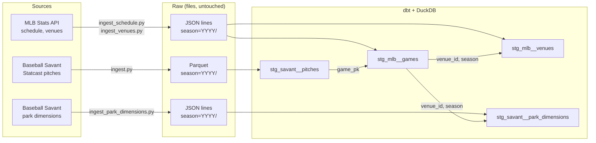

# statcast

A local data pipeline for MLB pitch-level data, built as the foundation for home run
prediction models. It pulls Statcast pitches, the MLB schedule, venue details and park
dimensions from public sources, then uses dbt to turn them into clean, tested
DuckDB tables.

**Status:** ingestion and staging are done for 2024–2026 (2.3M pitches, 7,420 games);
park factors and the modeling layer are in progress.

## Architecture



- **Raw layer:** each script saves what the source returned, unchanged, partitioned by
  season. Re-running a script is safe: files are replaced atomically, and duplicates
  are resolved downstream.
- **Staging layer (dbt):** one model per source table. Renames columns, fixes types,
  removes duplicates and flags which columns are post-pitch outcomes.
- **Tests:** 40 dbt tests run on every build, including cross-source checks
  ([dbt/README.md](dbt/README.md) lists each one and why it exists).

## Stack

Python (pandas, requests, pybaseball) · DuckDB · Parquet · dbt-core with dbt-duckdb

## Problems worth reading about

- **Duplicate games in the schedule.** A postponed game appears twice (the postponed
  date and the makeup date). A suspended game also appears twice, and both rows are
  marked `Final`. Joining pitches to the raw schedule would silently duplicate
  pitches. `stg_mlb__games` keeps one row per game, and a test proves every Statcast
  game matches exactly one schedule row on the same date.
- **Team is not park.** In 2025 the Rays played at a spring training park after
  hurricane damage, the A's moved to Sacramento, and games were played in Tokyo,
  Bristol and Williamsport. Park features join on the venue the game was played
  in, never the home team.
- **Parks change.** Camden Yards moved its left-field wall before 2025. Venues and
  park dimensions are stored as one snapshot per season and joined on
  `(venue_id, season)`.
- **Posted vs measured distances.** The distances painted on the walls don't line up
  across parks (Fenway's 420 sign is listed as "center"), so the models use Savant's
  measured distances and wall heights instead.
- **Leakage.** Columns describing what happened on a pitch (launch speed, events,
  win probability) are labeled in staging, and park factors will come from prior
  seasons only, so a model never trains on information from the future.
- **Tests that are proven to fail.** Each cross-source test was broken on purpose
  (by removing a season's file) to confirm it catches the problem.

## Running it

Requires Python 3.10+ (developed on 3.13).

```bash
python -m venv .venv
.venv/bin/pip install -r requirements.txt

# Load a season (the schedule must come before venues)
.venv/bin/python scripts/ingest.py --start 2025-03-01 --end 2025-11-05
.venv/bin/python scripts/ingest_schedule.py --season 2025
.venv/bin/python scripts/ingest_venues.py --season 2025
.venv/bin/python scripts/ingest_park_dimensions.py --season 2025

# Build and test
cd dbt && ../.venv/bin/dbt build
```

The database is created at `data/statcast.duckdb`. Raw data and the database are not
committed; a full season of Statcast is about 105 MB of Parquet.

## Repository layout

```
scripts/      ingest scripts, one per source (shared helpers in common.py)
dbt/          dbt project: sources, staging models, tests, data dictionary seed
data/         raw files and the DuckDB database (git-ignored)
```

## Roadmap

- [x] Statcast, schedule, venue and park dimension ingestion
- [x] Staging models with tests
- [ ] Park factors and park environment (Savant), prior-season only
- [ ] `dim_venue_seasons` mart and an incremental pitch fact table
- [ ] Scheduled daily runs
- [ ] Home run prediction models

## Data sources

[Baseball Savant](https://baseballsavant.mlb.com) and the
[MLB Stats API](https://statsapi.mlb.com). Data belongs to MLB Advanced Media. This is a
personal learning project; requests are made once per season with pauses between them.
