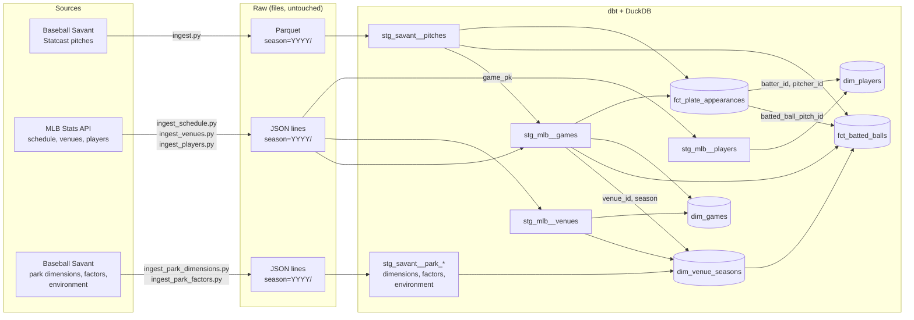

# statcast

[](https://github.com/jromer242/statcast/actions/workflows/dbt-ci.yml)

A local data pipeline for MLB pitch-level data, built as the foundation for home run
prediction models. It pulls Statcast pitches, the MLB schedule, venue details and park
dimensions from public sources, then uses dbt to turn them into clean, tested
DuckDB tables, and serves them in a Streamlit app.

**Status:** ingestion, staging and the marts are done for 2024–2026 (2.3M pitches,
560k plate appearances, 380k batted balls, 7,420 games, park data back to 2015). The
modeling layer is next.

## The app

A Streamlit app ([app/](app/)) puts any hitter's fly balls and line drives on any park's
walls ("would this have been a home run at Fenway?") and ranks hitters by season. It
reads three small extracts that dbt builds for it (about 3 MB of Parquet in `app/data/`),
so it runs anywhere without the 1.2 GB database. Run it locally:

```bash
.venv/bin/streamlit run app/streamlit_app.py
```

## Architecture



- **Raw layer:** each script saves what the source returned, unchanged, partitioned by
  season. Re-running a script is safe: files are replaced atomically, and duplicates
  are resolved downstream.
- **Staging layer (dbt):** one model per source table. Renames columns, fixes types,
  removes duplicates and flags which columns are post-pitch outcomes.
- **Marts layer (dbt):** tables built for analysis and models. `dim_venue_seasons` has
  one row per park per season with everything known about it before the season starts.
  `fct_batted_balls` has one row per ball in play, with its spray angle and the
  distance and height of that park's wall in the direction it went. It is built
  incrementally. `fct_plate_appearances` has one row per plate appearance (situation at
  the start, result at the end) and links to its batted ball; `dim_players` has one row
  per player, and `dim_games` one row per game.
- **Tests and contracts:** 81 dbt tests run on every build, including cross-source checks.
  Every mart also has an enforced contract (column names and types checked before
  building) and primary key and not-null constraints enforced on write
  ([dbt/README.md](dbt/README.md) lists each one and why it exists).
- **CI:** GitHub Actions builds every model and runs every test on each push and pull
  request, using a 4 MB committed sample of the raw data
  ([how it works](dbt/README.md#ci)).

## Stack

Python (pandas, requests, pybaseball) · DuckDB · Parquet · dbt-core with dbt-duckdb · Streamlit and Altair · GitHub Actions

## Problems worth reading about

- **Duplicate games in the schedule.** A postponed game appears twice (the postponed
  date and the makeup date). A suspended game also appears twice, and both rows are
  marked `Final`. Joining pitches to the raw schedule would silently duplicate
  pitches. `stg_mlb__games` keeps one row per game, and a test proves every Statcast
  game matches exactly one schedule row on the same date.
- **Team is not park.** In 2025 the Rays played at a spring training park after
  hurricane damage, the A's moved to Sacramento, and games were played in Tokyo,
  Bristol and Williamsport. Park features join on the venue the game was played
  in, never the home team.
- **Parks change.** Camden Yards moved its left-field wall before 2025. Venues and
  park dimensions are stored as one snapshot per season and joined on
  `(venue_id, season)`.
- **Posted vs measured distances.** The distances painted on the walls don't line up
  across parks (Fenway's 420 sign is listed as "center"), so the models use Savant's
  measured distances and wall heights instead.
- **Leakage.** Park factors are computed from a season's own home runs, so using the
  2025 factor for a 2025 pitch would leak the answer. `dim_venue_seasons` only uses the
  previous season's factors (a 2025 row gets 2022–2024), and a test guards the
  assumption that rule depends on. Columns describing what happened on a pitch (launch
  speed, events, win probability) are labeled in staging.
- **New parks have no history.** The A's in Sacramento and the Rays at Steinbrenner Field
  have no prior-season park factors, about 7% of 2025 pitches. A warning-level test lists
  them on every build instead of failing it, and the gap feeds a later lesson on
  handling missing data in the models.
- **Where's the wall?** Savant measures each wall at five points (both lines, both
  gaps, center) but doesn't say at what angle the gaps are. `fct_batted_balls`
  interpolates the wall along the ball's spray angle, and the gap angle (20°) was chosen
  by how well "distance past the wall" separates home runs from other fly balls and
  line drives. It works: that AUC is 0.997, versus 0.972 for raw distance. Angles from
  17.5° to 22.5° are nearly tied; [notebook 06](notebooks/06_wall_distance_auc.ipynb)
  walks through the AUC and re-checks the choice with a train/test split by season. A test
  checks that real home runs land beyond the computed wall.
- **Incremental tables drift.** Each run of `fct_batted_balls` only rebuilds the last
  week, so a re-pulled older date would silently go stale. A test compares it pitch
  by pitch with staging, and it was proven by deleting a day: the incremental run
  didn't restore it, and the test flagged 756 rows.
- **Not every at-bat is a plate appearance.** When the inning ends on the bases (caught
  stealing, pickoff), the batter's turn is cut short and they lead off the next inning
  with a fresh count. Savant gives that cut-short turn its own at-bat, labeled
  `truncated_pa` or with no event at all (about 1,300 on 2024–26). Counting them would
  inflate PAs and deflate every rate stat, so `fct_plate_appearances` flags them
  `is_completed_pa = false`, and a test checks that each one really ended its half-inning.
- **Tests that are proven to fail.** Each cross-source test was broken on purpose
  (by removing a season's file) to confirm it catches the problem.

## Running it

Requires Python 3.10+ (developed on 3.13).

```bash
python -m venv .venv
.venv/bin/pip install -r requirements.txt

# Load a season (the schedule must come before venues)
.venv/bin/python scripts/ingest.py --start 2025-03-01 --end 2025-11-05
.venv/bin/python scripts/ingest_schedule.py --season 2025
.venv/bin/python scripts/ingest_venues.py --season 2025
.venv/bin/python scripts/ingest_park_dimensions.py --season 2025
.venv/bin/python scripts/ingest_park_factors.py --season 2024 2025   # include the prior season
.venv/bin/python scripts/ingest_players.py --season 2025

# Build and test
cd dbt && ../.venv/bin/dbt build && cd ..

# Refresh the app's data (commit the result)
.venv/bin/python scripts/export_app_data.py
```

The database is created at `data/statcast.duckdb`. Raw data and the database are not
committed; a full season of Statcast is about 105 MB of Parquet.

## Repository layout

```
scripts/      ingest scripts, one per source (shared helpers in common.py)
dbt/          dbt project: sources, staging models, tests, data dictionary seed
ci/fixtures/  small committed sample of the raw files that CI builds from
app/          Streamlit app; app/data/ holds the Parquet extracts it reads
data/         raw files and the DuckDB database (git-ignored)
```

## Roadmap

- [x] Statcast, schedule, venue and park dimension ingestion
- [x] Staging models with tests
- [x] Park factors and park environment (Savant), prior-season only
- [x] `dim_venue_seasons` mart
- [x] Incremental batted-ball fact table (`fct_batted_balls`)
- [x] `fct_plate_appearances` and `dim_players`
- [x] `dim_games`, and enforced contracts on every mart
- [x] CI: dbt build and test on every push and pull request
- [x] Streamlit app: spray charts on any park's walls, and leaderboards
- [ ] Deploy the app on Streamlit Community Cloud
- [ ] Scheduled daily runs
- [ ] Home run prediction models

## Data sources

[Baseball Savant](https://baseballsavant.mlb.com) and the
[MLB Stats API](https://statsapi.mlb.com). Data belongs to MLB Advanced Media. This is a
personal learning project; requests are made once per season with pauses between them.
